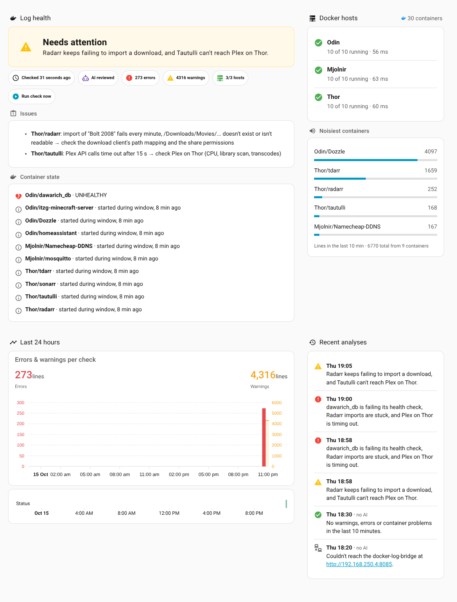

# Home Assistant: AI log analysis

The blueprint reads the last N minutes of Docker logs from the bridge every few
minutes, has an **AI Task** entity analyse them with `ai_task.generate_data`,
and notifies you when something needs attention.

Requires Home Assistant **2025.8+** with an AI Task entity set up (OpenAI, Google
Gemini, Anthropic, Ollama, …), under Settings → System → General → AI suggestions.

## 1. Add the REST command (once)

Home Assistant fetches the logs with a `rest_command`, so the blueprint gets
the JSON response back. Add this to `configuration.yaml` and restart HA:

```yaml
rest_command:
  docker_log_bridge:
    url: "{{ url }}"
    method: post
    content_type: application/json
    payload: "{{ params | to_json }}"
    timeout: 90
    # Only if you set API_TOKEN in bridge.env. The secret should hold
    # the whole header value, e.g. docker_log_bridge_auth: "Bearer abc123"
    # headers:
    #   Authorization: !secret docker_log_bridge_auth
```

The URL and parameters come from the blueprint, so one `rest_command` serves
any number of automations, e.g. one every 10 minutes for everything and another
for a single host with its own instructions.

**Test it:** Developer tools → Actions, switch to YAML mode, run the following with
"Return response" on:

```yaml
action: rest_command.docker_log_bridge
data:
  url: http://192.168.250.4:8084/api/logs
  params:
    minutes: 10
    level: warning
```

`content.text` is what the AI reads.

## 2. Import the blueprint

[](https://my.home-assistant.io/redirect/blueprint_import/?blueprint_url=https%3A%2F%2Fgithub.com%2Fzacharyd3%2Fdocker-log-bridge%2Fblob%2Fmain%2Fhome-assistant%2Fblueprints%2Fdocker_log_analysis.yaml)

Or go to Settings → Automations & scenes → Blueprints → Import blueprint and paste:

```
https://github.com/zacharyd3/docker-log-bridge/blob/main/home-assistant/blueprints/docker_log_analysis.yaml
```

Then **Create automation** from it.

## What you can configure

| Section | Option | Notes |
|---|---|---|
| Bridge | Bridge URL | `http://192.168.250.4:8084` by default; use the URL install.sh printed |
| Schedule | Run every | 5 / 10 / 15 / 20 / 30 min |
| | Look back | 0 = same as the interval (every line is analysed exactly once) |
| What to read | Docker hosts | Labels from `DOCKER_HOSTS`, e.g. `Thor, Mjolnir`; empty = all |
| | Only these / Exclude containers | Names or globs: `plex`, `*arr`, `Thor/*` |
| | Ignore lines matching | Regex, e.g. `GET /(health\|ping)` |
| | Minimum level | Everything / Info+ / **Warnings & errors** / Errors only |
| | Max report size | Characters sent to the AI (~4 per token) |
| AI analysis | AI Task entity | Empty = your default |
| | Extra instructions | Context about your setup, things to ignore |
| | Skip AI when nothing looks wrong | Default on: no AI call (and no cost) on quiet windows |
| Notifications | Notify at | Warning or worse / Critical only |
| | Persistent notification | Replaces itself, so they don't pile up |
| | Extra actions | Mobile push etc.; see the variables below |

Variables available to **Extra actions**: `analysis.status` (`ok` / `warning` /
`critical`), `analysis.summary`, `analysis.issues`, `notification_title`,
`notification_message`, plus `report` (the full bridge response, e.g.
`report.stats.errors`, `report.problems`, `report.hosts_down`).

Example mobile push:

```yaml
- action: notify.mobile_app_your_phone
  data:
    title: "{{ notification_title }}"
    message: "{{ analysis.summary }}"
    data:
      tag: docker-log-analysis
      group: docker
```

## 3. Dashboard (optional)



A status page for the latest check. It shows the AI's verdict and issues,
container state problems, live host reachability, the noisiest containers,
24-hour trends, and a timeline of recent analyses. It also has a **Run check
now** button.

**a. Install the cards from HACS (Frontend):** Mushroom, ApexCharts Card and
card-mod.

**b. Add the package.** It creates the sensors and the "run now" script:

1. If you don't use packages yet, add this to `configuration.yaml`:
   ```yaml
   homeassistant:
     packages: !include_dir_named packages
   ```
2. Copy [`packages/docker_log_bridge.yaml`](packages/docker_log_bridge.yaml)
   to `/config/packages/`. If your bridge isn't on `192.168.250.4:8085`, change
   the `resource:` URL in it.
3. Restart Home Assistant.

It creates these entities:

| Entity | |
|---|---|
| `sensor.docker_log_health` | `ok` / `warning` / `critical` / `error` (bridge unreachable). Attributes: summary, issues, problems, noisiest, history (last 15 notable runs), … |
| `sensor.docker_log_errors`, `sensor.docker_log_warnings` | Counts from the latest check, recorded for graphs |
| `sensor.docker_container_problems` | Number of container state problems (unhealthy, restart loops, …) |
| `sensor.docker_hosts_online`, `sensor.docker_containers_running` | Polled from the bridge every minute, independent of the schedule |
| `script.docker_log_analysis_run_now` | Triggers your blueprint automation immediately |

The sensors fill in on the next run of the blueprint automation, or press
**Run check now**. They keep their values across restarts.

**c. Create the dashboard.** Go to Settings → Dashboards → Add dashboard → "New
dashboard from scratch". Open it, then ⋮ → Edit → ⋮ → Raw configuration editor,
and replace everything with
[`dashboards/docker_logs.yaml`](dashboards/docker_logs.yaml).

## Costs and tips

* With **Skip AI when nothing looks wrong** on and **Warnings & errors**, most
  runs on a healthy server never call the AI.
* A noisy container fills the prompt. `report.noisiest` lists the top talkers.
  Add the noise to *Ignore lines matching*, or set `IGNORE_PATTERN` in
  `bridge.env` to drop it for every automation.
* Errors that keep recurring will be reported on every run. Use *Extra
  instructions* to tell the AI what is known or expected ("the Thor backup
  container fails its first attempt every night, ignore it").
